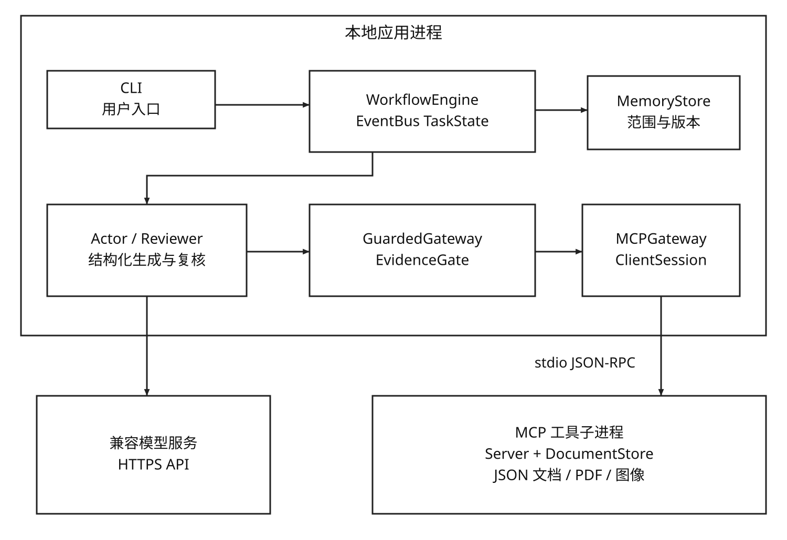

# DocAgent UML MCP

一个可运行的多智能体文档问答教学项目：用 UML 定义角色、状态和交互，用事件队列调度 Actor 与 Reviewer，通过真实 MCP 进程读取文档，并在输出和记忆写入之前核验引用来源。

本项目受到 [DocAgent（EMNLP 2025）](https://aclanthology.org/2025.emnlp-main.893/) 启发，是独立实现的课程研究原型。这里的 `baseline` 重建原论文的顺序协作思想，**不是作者代码的完整复现，也没有复现论文的公开长文档基准分数**。

## 已实现的能力

- Actor、Reviewer 分别进行工具检索和回答/复核，可接入真实兼容模型 API。
- 官方 MCP Python SDK 的真实 `stdio` client/server，协议固定为 `2025-06-18`。
- 文档大纲、关键词搜索、章节读取、图像读取、页面图像和表格图像六个工具。
- FIFO 事件队列、状态迁移约束、超时、有限重试、取消、同一任务内重复读取合并。
- 引用检查：文档 ID、页码、元素 ID、类型和原文片段必须与源一致。
- 文档范围内的结构化记忆、去重、版本、冻结，以及使用前的来源复核。
- 文本 PDF 导入、30 题真实模型评测脚本、55 组故障与消融实验、纯图像输入补充实验。
- 六类 UML 的 PlantUML 源、SVG 和 PNG；独立的真实 Java `ActionListener` 示例。



## 快速开始

需要 Python 3.12 或以上。以下命令在仓库根目录运行。

```powershell
python -m venv .venv
.\.venv\Scripts\python -m pip install -r requirements.lock
.\.venv\Scripts\python -m pip install --no-deps -e .
.\.venv\Scripts\python -m docagent tools
.\.venv\Scripts\python -m docagent demo
```

Linux/macOS 将 Python 路径替换为 `.venv/bin/python`。`requirements.lock` 固定本次验证环境，并对 `pywin32` 使用平台条件。也可以使用 `python -m pip install -e ".[dev]"` 安装声明依赖。

`demo` 不需要 API 密钥，它运行**离线摘录流程**，只用于验证调度、MCP 与出处检查。它不是语言模型，不能用其结果宣称模型问答准确率。

### 真实问答

使用环境变量配置模型，不把密钥写入源码或命令行参数。`.env.example` 是配置说明，应用不会自动加载 `.env`。

```powershell
$env:DEEPSEEK_API_KEY = 'your_key'
$env:DOCAGENT_MODEL = 'deepseek-flash'
$env:DOCAGENT_BASE_URL = 'https://api.deepseek.com'
.\.venv\Scripts\python -m docagent ask '港湾系统的试点规模为多少名读者？' --doc-id harbor
```

也可设置 `DOCAGENT_API_KEY`，其优先级高于 `DEEPSEEK_API_KEY`。其他提供兼容 Chat Completions 接口的模型可以替换 `DOCAGENT_BASE_URL` 和 `DOCAGENT_MODEL`。API 模式会把**所选文档的检索内容**发送给配置的模型服务。

回答、引用、状态事件及计数默认保存在 `outputs/last_run.json`，记忆默认保存在 `outputs/memory.json`。这两个目录不会提交到 Git。

### 图片与 PDF

```powershell
# PDF 按页提取文本，中文文件名请显式指定 ASCII 文档 ID。
.\.venv\Scripts\python -m docagent import-pdf 'input.pdf' --doc-id manual01
.\.venv\Scripts\python -m docagent ask '文档说明了什么？' --data-dir data/documents --doc-id manual01

# 模型支持图片时，MCP 返回的图像会以 image_url 输入模型。
$env:DOCAGENT_VISION = '1'
.\.venv\Scripts\python -m docagent ask '图一中 East 的完成数是多少？' --data-dir examples/vision/documents --doc-id vision_lab
```

PDF 导入器采用页文本启发式，不做 OCR、复杂阅读顺序恢复或自动图表识别。导入文档仍可通过 `get_page_images` 读取页面图像。附带的三份结构化方案及图表是合成教学资料，其图表描述不是实际业务测量结果。

## 三种运行模式

| 模式 | 执行路径 | 工具层 | 输出和记忆策略 |
| --- | --- | --- | --- |
| `baseline` | Actor → Reviewer 顺序调用 | 本地同语义工具 | 回答文本变化触发未验证经验 |
| `engineered` | EventBus 驱动 | MCP + GuardedGateway | 与基线保持相同回答策略 |
| `optimized` | EventBus + 证据守卫 + 有限修订 | MCP + GuardedGateway | 引用核验；有来源的纠错候选才可入记忆；读取时重验 |

例如 `python -m docagent ask '问题' --doc-id harbor --mode optimized`。

`ActionListener` 只提供回调接口，线程与异步执行由事件源及执行器决定。这里的 Python `EventBus` 借鉴其监听思想，实际调度规则由 `WorkflowEngine` 和状态机承担。MCP 负责工具发现与调用，不充当应用的业务调度器。[Java 实例](examples/java/README.md) 给出对应关系和可编译的事件示范。

## 验证与实验

```powershell
.\.venv\Scripts\python -m pytest -q
.\.venv\Scripts\python -m ruff check src tests
.\.venv\Scripts\python -m docagent faults
.\.venv\Scripts\python -m docagent evaluate --concurrency 3 --resume
```

`faults` 运行 11 场景 × 5 变体，使用确定性脚本角色，**不调用模型**。它单独检验引用伪造、历史记忆污染、重试和消融效果。`evaluate` 调用真实模型；每题使用独立的空且冻结的记忆，防止评测题顺序学习。逐题 JSON 支持断点续跑，模型、问题文件和文档变化会使已有记录的指纹失效。

本次 30 题 × 3 模式的 `deepseek-flash` 文本实验：

| 指标 | baseline | engineered | optimized |
| --- | ---: | ---: | ---: |
| 核心答案规则通过 | 30/30 | 30/30 | 30/30 |
| 平均底层工具调用 | 8.57 | 5.47 | 5.80 |
| 平均工作流耗时（秒） | 6.10 | 6.33 | 6.50 |
| 模型请求总数 | 172 | 170 | 174 |

工作流计时不包含 MCP 子进程启动和关闭，并受到并发 3、网络与服务端波动影响。优化版工具调用较基线少约 32.3%，主要来自重复读取合并；这些数据没有证明准确率提升或整体加速。

规则评分检查必需数值/术语和回答状态，不等价于完整语义正确。按源文复查发现 **6 份回答的附加解释有过度推断或错误概括**，尽管核心答案/拒答判定通过。详细口径、逐题结果、消融和局限见 [实验说明](docs/experiments.md) 与 [公开验证记录](results/README.md)。

## 设计与项目结构

```text
src/docagent/
  agents.py         模型 HTTP 适配与 Actor/Reviewer
  core.py           事件、状态机、受控调用、证据与记忆
  documents.py      统一文档模型和只读工具
  mcp_server.py     官方 SDK 工具服务
  gateway.py        LocalGateway / MCPGateway
  evaluation.py     不向 Agent 暴露标签的真实模型评测
  robustness.py     故障注入与消融
  cli.py            命令行入口
examples/           匿名虚构资料、问题、Java 监听示例
docs/uml/           用例、组件、类、状态、时序、活动图
tests/              单元、真实 MCP 与长文档集成测试
results/            已审查的公开实验记录
```

参见 [设计与需求追踪](docs/design.md) 和 [UML 图目录](docs/uml/README.md)。`WorkflowEngine.cancel(task_id)` 是程序接口；当前 CLI 没有单独的交互式任务管理界面。状态和去重都保存在本进程内，不声称分布式 exactly-once 或崩溃恢复。

## 重要边界

1. **真实引文不能自动证明结论正确。** EvidenceGate 验证身份与原文片段；“原文2000人，回答9000人”的语义错误仍可能通过，需要 Reviewer 和独立评测检查。
2. 原型的记忆可信标记表示来源校验通过，不表示经验已获人类批准或一定适用于所有问题；按文档隔离，并在使用前重新检验来源。
3. 合成30题存在明显难度上限；120页工程测试只验证解析、检索和末页图像传输，不证明原论文级长文理解表现。
4. 公开仓库只保存匿名代码、样例与实验数据。课程报告、模板、个人文档、密钥和常规运行输出位于仓库外或被忽略，不作为公开成果上传。

## 参考与许可

- [原论文](https://aclanthology.org/2025.emnlp-main.893.pdf) 与 [官方 DocAgent 仓库](https://github.com/lisun-ai/DocAgent)
- [Oracle ActionListener](https://docs.oracle.com/javase/8/docs/api/java/awt/event/ActionListener.html)
- [MCP 2025-06-18 工具规范](https://modelcontextprotocol.io/specification/2025-06-18/server/tools)
- [MCP 生命周期](https://modelcontextprotocol.io/specification/2025-06-18/basic/lifecycle)
- [MCP Python SDK](https://github.com/modelcontextprotocol/python-sdk)
- [DeepSeek 图像输入](https://api-docs.deepseek.com/guides/vision/)

本项目独立编写的代码采用 [MIT License](LICENSE)。第三方库及原论文使用各自许可。
